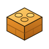
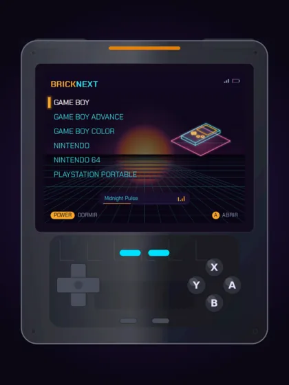
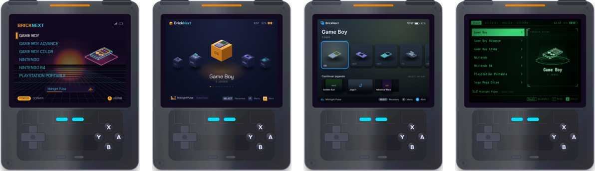
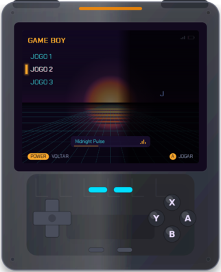
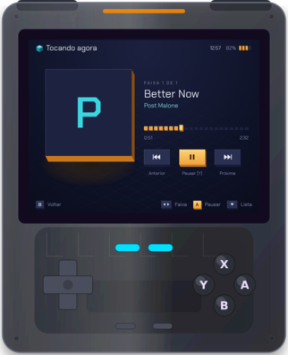
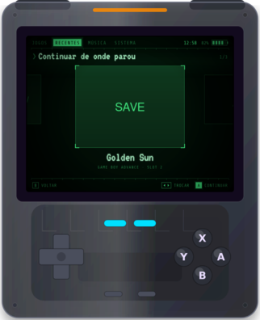
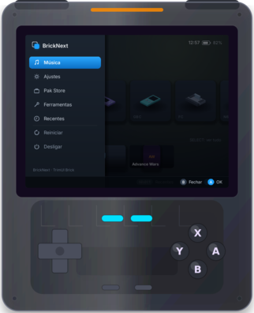
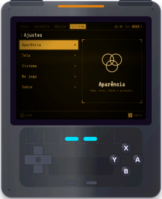
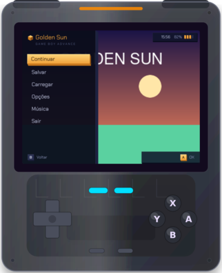
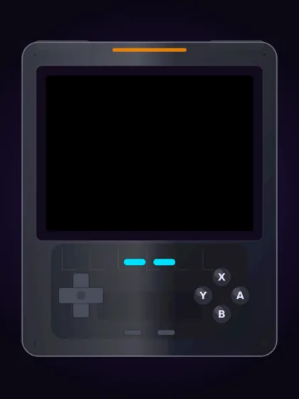

  

<h1 align="center">BrickNext</h1>

  <b>NextUI para o TrimUI Brick, com quatro temas próprios, LEDs no tema e o player AnberTunes.</b> 
  <i>NextUI for the TrimUI Brick, with four themes of its own, themed LEDs and the AnberTunes player.</i>

  <a href="https://github.com/retrotiv/BrickNEXT/releases/latest">Download</a> ·
  <a href="docs/UPDATE.md">Atualizar / Update</a> ·
  <a href="https://ko-fi.com/retrotiv">Ko-fi</a>

  

---

## Português

BrickNext é a adaptação do **NextUI** para o **TrimUI Brick**, feita pela retrotiv. Mantém tudo o que
o NextUI faz e traz o visual do AnberNext: tela inicial, biblioteca de jogos, menu dentro do jogo,
Ajustes e animação de boot novos, em quatro temas, e o **AnberTunes**, um player de música que toca
durante os jogos.

### Quatro temas

  

**Neon Drive** (synthwave), **Bloco** (blocos isométricos), **Grafite** (cartões limpos) e
**Fósforo** (terminal de fósforo verde, âmbar ou branco). Cada um com seus jeitos de mostrar os
consoles (carrossel, lista ou grade) e os jogos, e com prévia ao vivo nos Ajustes.

### Tudo no tema

<table>
  <tr>
    <td align="center"> <b>Biblioteca</b> capas, último save, tempo de jogo</td>
    <td align="center"> <b>Música</b> também durante os jogos</td>
    <td align="center"> <b>Continuar jogando</b> de volta ao save exato</td>
  </tr>
  <tr>
    <td align="center"> <b>Menu rápido</b> música, ajustes, ferramentas</td>
    <td align="center"> <b>Ajustes</b> tudo no visual do tema</td>
    <td align="center"> <b>Menu do jogo</b> salvar, carregar, opções, música</td>
  </tr>
</table>

### Boot e LEDs no tema

  

Depois do logo da TrimUI entra a animação de boot do tema escolhido, e os **LEDs** acendem nas
cores dele. Em **Ajustes > Aparência > LEDs** você escolhe **Seguir o tema** (boot, menu e jogos)
ou **Personalizado**, com os controles do LED Studio: luzes, efeito, cores prontas, matiz,
saturação, brilho, vermelho/verde/azul e velocidade. A chave de mute continua apagando os LEDs.

### O que vem junto
- **AnberTunes** integrado, com o cartão "tocando agora" no menu do jogo e, por overlay, no
  **PSP** (OpenGL e Vulkan), **N64** e **Dreamcast** (OpenGL). O AnberTunes é um fork do
  **[Boombrick](https://github.com/ujjwal313/boombrick)**, de **[ujjwal313](https://github.com/ujjwal313)**:
  o app, e todo o trabalho por trás dele, é do autor do Boombrick.
- **PSP, N64 e Dreamcast** já preparados, e o **Pak-Plaza**, a loja de paks da retrotiv.
- **Atualizações travadas no repo da retrotiv**: o BrickNext só aceita o que a gente publicar aqui.

### Como instalar
1. Baixe a release mais recente em **[Releases](https://github.com/retrotiv/BrickNEXT/releases/latest)**.
2. Extraia todo o conteúdo do zip na raiz de um cartão vazio, formatado em FAT32 ou exFAT.
3. Coloque o cartão no Brick e ligue: ele se instala sozinho no primeiro boot.
4. Coloque suas **BIOS** em `Bios/` e suas **ROMs** em `Roms/`, cada uma na pasta do console.
   BIOS e ROMs **não** acompanham o BrickNext.

Depois de instalado, para pegar versões novas basta abrir **Tools -> BrickNext Update** com o Wi-Fi
ligado. Não precisa regravar o cartão. Veja [docs/UPDATE.md](docs/UPDATE.md).

## English

BrickNext is retrotiv's adaptation of **NextUI** for the **TrimUI Brick**. It keeps everything NextUI
does and brings AnberNext's look: a new home screen, game library, in-game menu, settings and boot
animation in four themes, plus **AnberTunes**, a music player that keeps playing in your games.

- **Four themes**: Neon Drive, Bloco, Grafite and Fósforo, each with its own layouts and live
  previews in Settings.
- **Themed boot and LEDs**: the boot animation and the LEDs follow the theme; **Settings > Appearance
  > LEDs** picks *Follow the theme* or *Custom*, with LED Studio's controls (lights, effect, ready
  colors, hue, saturation, brightness, red/green/blue, speed). The mute switch still turns them off.
- **AnberTunes** built in, with the now-playing card in the in-game menu and, via overlay, on **PSP**
  (OpenGL and Vulkan), **N64** and **Dreamcast** (OpenGL). AnberTunes is a fork of
  **[Boombrick](https://github.com/ujjwal313/boombrick)** by **[ujjwal313](https://github.com/ujjwal313)**:
  the app and the work behind it are theirs.
- **PSP, N64 and Dreamcast** ready to go, and **Pak-Plaza**, retrotiv's pak store.
- **Updates locked to retrotiv's repo**: BrickNext only takes updates we publish here.

**Install:** download the latest **[release](https://github.com/retrotiv/BrickNEXT/releases/latest)**,
extract the whole zip to the root of an empty FAT32/exFAT card, put it in the Brick and power on: it
installs itself on first boot. Then add your **BIOS** to `Bios/` and **ROMs** to `Roms/` (not
included). Later versions come from **Tools -> BrickNext Update**, on Wi-Fi, with no re-flashing.

---

## Créditos / Credits

BrickNext é construído sobre o **NextUI**, da **LoveRetro**
(<https://github.com/LoveRetro/NextUI>), que por sua vez vem do **MinUI**, de Shaun Inman. O visual
vem do **AnberNext** (<https://github.com/retrotiv/AnberNext>), e o player AnberTunes é um fork do
**Boombrick**, de ujjwal313 (<https://github.com/ujjwal313/boombrick>). Os emuladores e cores pertencem aos
seus autores. Veja [NOTICE](NOTICE). Foto do aparelho: TrimUI. O BrickNext é um projeto da
comunidade, sem ligação com a TrimUI.

Licença **PolyForm Noncommercial 1.0.0** (veja [LICENSE](LICENSE)): projeto **não comercial**, com os
créditos preservados.
